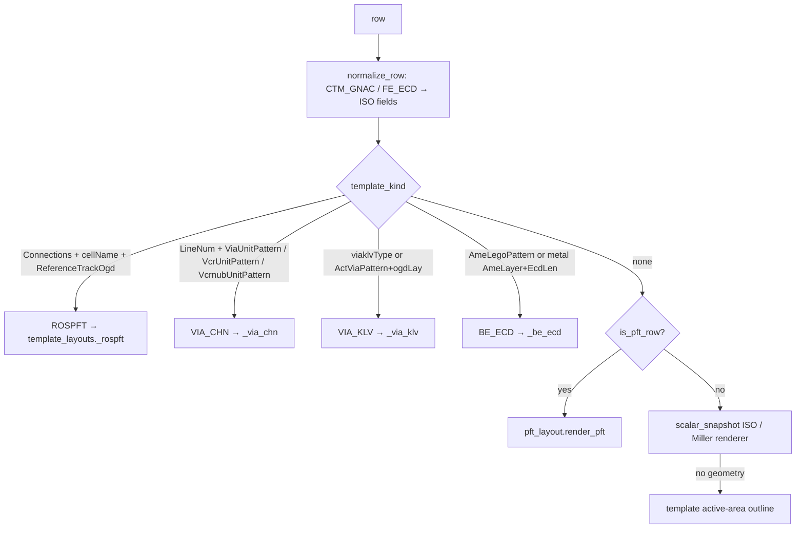

# 5. Template builders (non-ISO Atlantis templates)

Besides ISO, Atlantis test rows use other templates. Each has its own parameter language; the GUI detects
the template from the row fields and routes it to a dedicated preview. Parameter meanings come from the
Atlantis template definitions (`templates` bridge op → `GetOrderedTemplates` help text), the generator
bundles and the catalog decks.

## Dispatch

`StructureDesigner.layout_png` ([iso_structure_ai.py](../iso_structure_ai.py)) checks, in order:

| Template | Libraries (X81) | Example names | Preview |
|---|---|---|---|
| ISO (CTG, GATEGATE, EPIEPI, TCNTCN, DIFFOGD, DIFFCHN) | `isox81z` | `CTG132-NZ5-S-A:SDR:OGD:REF:2TRK` | `scalar_snapshot` |
| MOS_PFT_X81Z (XTRPFX) | `xtrpfx81z` | `NS132-Z5-L-1L-CMOS-0X1-IXI-SH-…`, `FKNS44-132-Z5-L-TCN:OGD:CD:N2` | `pft_layout` |
| MLR (XTRCAP, Miller) | XTRCAP rows, e.g. test rows `x81zs_nm_ply03/04` | `NM-132-Z5-L-1ADF-CMOS-M2-PLYCDPP:N1` | `scalar_snapshot` (Miller mode) |
| CTM_GNAC_X81Z | with PFT/ROSPFT rows | `GNAC-10-SF` | ISO renderer via `normalize_row` |
| FE_ECD_X81Z (gate/TCN KLV) | `conx81z` | `NGATEKLV132-Z5-S-SDR`, `NTCNKLV132-Z5-L-CD10` | ISO renderer via `normalize_row` |
| VIA_CHN_X81Z | `bechnx81z`, `conx81z` | `V0_VCHN_M0C/M1_12/9_24/20_24X12_DR_110H`, `VCR_VCHN_TCN/M0C_…`, `TCNVCR-CHN-…` | `_via_chn` |
| BE_ECD_X81Z | `bemetx81z` | `M0_ECD_B_12_9_30UM_DR_110H` | `_be_ecd` |
| VIA_KLV_X81Z | `beviax81z`, `conx81z` | `V0_KLV_M0B/M1_…`, `VGKLV132-NZ5-L-SDR`, `VCR_KLV_TCN/M0B_…` | `_via_klv` |
| CTM_PFT_X81Z (ROSPFT) | `xtrmiscx81z` | `ROSN132-Z4-L-2L-INV-0X1-IXI-SH-M1-WAC-1X` | `_rospft` |

Units are shared with the ISO preview (x = 44 nm poly pitch, y = CH/2 nm) so rulers, measurement and Snap work
everywhere. Widths come from the CD/space pairs in names (`…_M0C/M1_12/9_24/20_…` → M0 12 nm CD, 21 nm pitch)
or preview defaults.

## MOS_PFT (XTRPFX) — `pft_layout.py`

### Generator bundle (`PFT_LLM.bat`)

| Payload | Role |
|---|---|
| `claude_pft_generator.py` (2,544 lines) | Decoder → PFT buildsheet. Engines: **tuned** (rule-based hybrid with lookup tables), **lookup** (weighted nearest neighbour), **sklearn** (per-column models). Generates FTI matrices, DiffLegoPattern, DrawDevFlav, DrawMiscIDs, PDK columns, LVS device data, instance/nesting variants |
| `Decoder_Mini.csv` / `PFT_Mini.csv` | 88 training decoder rows (27 cols) and buildsheets (69 cols) |
| `MOS18_PadConfig.csv` | 18 pad configurations |
| `claude_gds_generator.py` | GDS generator with `--mode train/generate/validate/info` |
| `trained_model.zip` | `gds_templates.pkl` (19.7 MB), `pft_models.pkl`, `via_patterns*.json`, `ctcn_patterns*.json`, `flavor_patterns.json`, `vtid_patterns.json` |

**Training of the PFT GDS generator** (`TemplateBuilder`): parse the training GDS
(`x81zs_testrow2/4/5_inst*.oasis.txt`, 40 designs) → group by `(CELLHEIGHT, MOS, PFTTYPE)` into **16 base
templates** (`110/132/165 × N/P × CMOS/CMOS_A/UNI`) → model **18 delta transforms** (layer additions/removals)
for NESTING (`0X0, 0X2, 1X1, 2X2, 5X5` vs `0X1`/`1X1`), NEST_FTILENGTH (`HXH` vs `FXF`) and STACKEDFTI (`3` vs
`0`) → capture byte-identical via (V0/V1/M1FILL) and CTCN pattern sets as JSON.

### Preview pipeline

1. `_ensure_assets` unpacks the payloads once into `extracted/pft/` (zip path traversal checked).
2. `_generator` loads the pickle with a **class allow-list** unpickler (`DesignTemplate, LayerTemplate,
   DeltaTransform, Polygon` only).
3. `pft_rows` builds the decoder row from the bundled table (exact name) or decodes the structure name
   (`NS132-Z5-L-1L-CMOS-0X1-…`, loose `FKNS44-…` form + `DiffLegoPattern`), and takes the PFT buildsheet from the
   row’s own fields when present.
4. `pft_gds` writes GDS2 text cached by a hash of the generator inputs.
5. `render_pft` draws it with `klayout_layer_map.lyp` colours and overlays the **buildsheet pins** (`DrawGATE,
   DrawSS, DrawSF, DrawDS, DrawDF, DrawTOPSOURCE, DrawTAP`; format `track,m0|L/R,m1` with `/` = next
   terminal, `;` = more vias, `~vcr` = via on the VCR rail) and VCRNUBs.
6. Post-processing (added after catalog comparisons, because the generator replays a generic template):
   * `merge_pin_cuts` — removes PLY/TCN cuts between every pin and the device row
     (`PolyMatrix`/`TcnMatrix` reference diffusion track), so Kelvin TCNs (SF1–SS1, DS1–DF1) and Gate2 polys
     are continuous as in the FKTCN catalog.
   * DrawGATE blocks beyond the second map to terminal **GATE2** (template has GATE1/GATE2 only).
   * `apply_pft_skews` — the generator ignores every skew (widths stay 12 nm); PolyCD + PP (`PP;CD;TCN`),
     poly/TCN CD/REG, `poly:TSDRn12A` IDs and FTI CD/REG are applied to PLY/TCN/FTI/vias between the FTI walls
     around the device, and listed in a footer.
7. `_active_shapes` traces conductors from pins (VG→PLY/M0, VT→TCN/M0, VCRNUB→TCN/VCR); `active_window` crops
   to pins + their PLY/TCN + VCRNUBs (min 16 PP × 4 tracks); **Full cell** shows everything.

Layers: `NDIFF, PDIFF, FIN, PLY, TCN, CTCN, FTI, VG, VT, VCR, VCRNUB, TRM, M0, V0, M1, V1, M2, VT flavor IDs,
Dummy fill, IDs / other, Full cell, Grid`. Cache token `_w4_`.

Key MOS_PFT parameters (help text): `structureSize` (diff tracks;poly tracks), `DiffLegoPattern`
(`nppn…/width`), `FTITracks`, `FtiMatrix`/`PolyMatrix`/`TcnMatrix` (`refPoly,refDiff;X,Y;ROW:pattern` —
1 = draw FTI / remove cut), `MergeFECuts`, `VcrPattern`, `VcrnubPattern`, `TcnExtension`, `DrawDevFlav`,
`DrawMiscIDs`, `IdLayerBasedSkew`, `PolyCdSkew`, `FTICdMisregSkew`, `TCNCdRegSkew`, `PXLSkew`, `GLKSkew`,
`TCPSkew`, `HorizontalPFTsConfig`, `VerticalPFTsConfig`. Terminals: GATE1, SS1, SF1, DS1, DF1, TOPSOURCE1,
GATE2, SF2, SS2, DF2, DS2, TOPSOURCE2, TAP1.

## MLR (XTRCAP) — Miller buildsheets

`MLR_LLM.bat` embeds `mlr_gui.py`, `claude_mlr_generator.py` (1,624 lines; tuned / lookup / sklearn engines,
CELLHEIGHT 110/132/165, PFTTYPE CMOS, CELLTYPE SH/DH, ArraySize parametric), `MLR_Decoder.csv` +
`MLR_Mini.csv` (47 training rows, 74 buildsheet columns) and `MLR28_PadConfig.csv`. **There is no MLR GDS
generator**, so MLR rows are drawn by the ISO renderer in Miller mode:

* vias and VCR carry terminal tags `?DF/?SF/?GF/?TAP` (`is_miller_row`), coloured by terminal net;
* `DF/SF/GF/TAP ActiveTracks` and Data fields define terminals; LO1/HI1 layers are hidden;
* only `DiffPatternGlobal` exists, projected onto the first unit cell (`unit_diff_segments`);
* VCRNUB uses the PFT-measured 44 × 13.4 nm;
* PW skews (PolyCD + PP `PLYCDPP`, PolyCD/TCN CD inverse `PLYiTCN`, ID skews) are drawn from §1.5.

## CTM_GNAC

GNAC rows (`GNAC-n-SF/GATE`, terminals GNAC, CNODE, TAP) use ISO-style unit patterns. `normalize_row` maps
`NumTcnTracksUnitCell → UnitCellSizeOgd`, `NumDiffPairsUnitCell → UnitCellSizePgd`, `Array2D → ArraySize*`,
`PolyPitch = pp44`; vias tagged `?GNAC/?CNODE` are traced as Miller-style nets.

## FE_ECD (gate / TCN Kelvin)

FE_ECD rows (`AmeLayer = poly` gate KLV, `AmeLayer = tcn` TCN KLV) are mapped onto an ISO unit cell:

| ISO field | From |
|---|---|
| `UnitCellSizeOgd` | `2·line` (poly) or `2·line + 1` (TCN, keeps the slot centred), line = first `vg`/`vt` X in `VcxPatternUnit` |
| `UnitCellSizePgd` | `ceil(EcdLen / CH)` cells |
| `ArraySizeOgd` | `ArrayNum` |
| `DiffPatternUnit`, `FTITracksUnit` | `DiffPattern`, `FTIPattern` |
| `PolyPlugsUnit` / `TcnPlugsUnit` | `line,1:cells−1` (one continuous ECD line) |

Every VG/VT is put on the `ECD` net (`_default_via_net`). TCN KLV support was added after the corpus showed
all `NTCNKLV/NPTCNKLV/PTCNKLV` rows (9 test rows) had no preview.

## VIA_CHN — `_via_chn`

`OgdLay`/`PgdLay` line grids (`LineNum = ogd;pgd`), vias at `ViaUnitPattern` `pgdLine,ogdLine` in chain order
(`|` separates sub-chains), chain segments derived from consecutive vias, `UnitCellNum` array. TCN–VCR chains
(`VcrUnitPattern tcnRange,vcr`, `VcrnubUnitPattern tcn,vcr,top|bottom|…`) draw VCR rails on the CRL and
VCRNUBs; rows with only VCR patterns (`VCR_VCHN…`) are recognised as VIA_CHN. Layers: OGD lines, PGD lines,
Vias, Chain path, VCR / VCRNUB, Grid. Cut guides are not drawn.

## BE_ECD — `_be_ecd`

`AmeLegoPattern` (`CD;SPC;…:repeat` µm) stack of lines, active line `AmeLineNum`, length `EcdLen` µm, force /
sense vias at `ForceViaPattern`/`SenseViaPattern` on the `Routelayers` route. Default view is the left 1.5 µm
tap region; **Full length** shows the whole line.

## VIA_KLV — `_via_klv`

`ogdLay`/`pgdLay` grids (`ogdLegoList`/`pgdLegoList` counts, `ogdJumperLinesTB`), active Kelvin via
`ActViaPattern` (`p,o,w,h`), dummy vias `DumViaPattern`, pins `iLOPin/iHIPin/vLOPin/vHIPin`
(`n; tracks; guides[G|J]; side; edge`). Added from the MOL KLV catalog: `DrawDiff` diffusion (diffusion-track
pitch) with TCN between poly lines when `pgdLay = poly`, and `pgdCutPattern` removed poly segments (line-end
enclosure studies). `ogdCutPattern` is not drawn.

## CTM_PFT (ROSPFT) — `_rospft`

Ring-oscillator PFTs probe one device inside a library standard cell (`cellLibrary/cellName`, e.g.
`rosx81z/x81z_P81ROS_…_INV_Z4X2_LVT…`). Upper layers are deleted (`deleteLayers`, `deleteLppsInBBox`) and
Kelvin pins are added:

| Field | Meaning |
|---|---|
| `ReferenceTrackOgd` | `m0,185` — M0 index 0 |
| `ReferenceTrackPgd` | `poly,43;tcn,31;m1,43` — poly/TCN/M1 index 0 (44 nm pitch; TCN t between poly t and t+1) |
| `Connections` | `net,m0,track,layer,index` — e.g. `ss,m0,4,tcn,2` (VT), `gate,m0,2,poly,3` (VG), `sf,m0,5,m1,3` (V0), `dv0,m0,8,m1,4:30[2]` dummy V0 |
| `Routes` | `PIN,net,left/right,m0,m1,…` — pin escape side |
| `PinDirs`, `Cuts`, `Conversions`, `CustomTracks`, `AddIDLayers` | pin edge, TCN/M0 cuts, M0 conversions, custom tracks, IDs (not drawn) |

The preview draws a neutral poly/TCN/M0 grid (the standard cell itself is not in the buildsheet), the device
diffusion and TCNs, each pin net on its M0 track extended toward its route side and labelled, VT/VG/V0 vias,
M1 straps and dummy V0. Multi-instance (`…-6X_n`) rows show every instance. Checked against
`X81Z_TC_ROSPFT_catalog.pptx` (N: SF top, DF bottom; P mirrored).

## Generator comparison

| Generator | Bundle | Training data | Engine(s) | Geometry |
|---|---|---|---|---|
| ISO buildsheet | ISO_LLM.bat | 33 decoder/buildsheet pairs | tuned (index + formulas + DSL) | — |
| ISO GDS | ISO_LLM.bat | 12 CTG132 chassis GDS | chassis + delta transforms | GDS ASCII |
| PFT buildsheet | PFT_LLM.bat | 88 pairs | tuned / lookup / sklearn | — |
| PFT GDS | PFT_LLM.bat | 40 PFT GDS (testrow2/4/5) | 16 templates + 18 deltas (pickle) | GDS ASCII |
| MLR buildsheet | MLR_LLM.bat | 47 pairs | tuned / lookup / sklearn | none |
