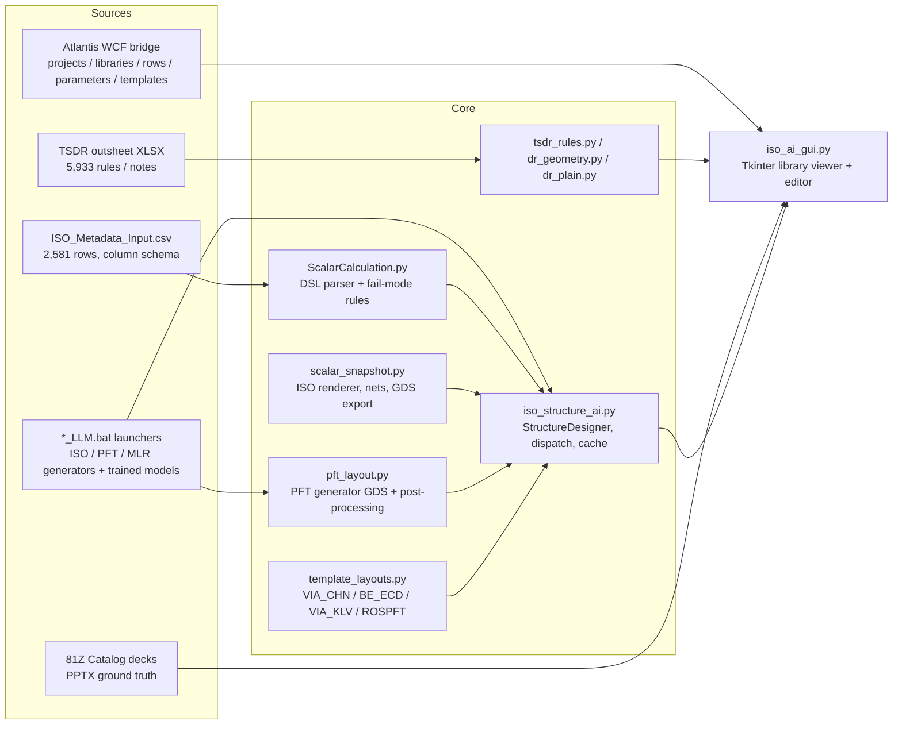

# MetadataScalarISO — documentation set

This folder documents the ISO content builder, the other Atlantis template builders it can show, and how the
ISO generator and its previews were built, trained and verified. The repository [README](../README.md) remains
the user-facing quick reference for the GUI; these pages explain *how and why* things work.

| # | Document | What it covers |
|---|---|---|
| 1 | [Buildsheet DSL](01_buildsheet_dsl.md) | ISO buildsheet fields, axis grammar (`a:b[step]`, `rK`, `/`, `;`, `\|` skews), coordinate frames, M0 track model, global/buffer fields |
| 2 | [Scalar calculation](02_scalar_calculation.md) | Fail-mode counting per family (CTG, GATEGATE, EPIEPI, TCNTCN, DIFFOGD, DIFFCHN), outputs, validation, verified results |
| 3 | [ISO layout renderer](03_iso_layout_renderer.md) | `scalar_snapshot.py`: unit / global / full-structure views, layers, current-flow trace, skews, TSDR IDs, KLayout GDS export, performance |
| 4 | [ISO generator and training](04_iso_generator_and_training.md) | `ISO_LLM.bat` payloads, decoder-DSL generator, chassis+delta GDS generator, prompt designer, feedback learning, what "training" means here |
| 5 | [Template builders](05_template_builders.md) | MOS_PFT (XTRPFX/FKTCN), MLR (XTRCAP), CTM_GNAC, FE_ECD (gate/TCN KLV), VIA_CHN, BE_ECD, VIA_KLV, CTM_PFT (ROSPFT) |
| 6 | [Atlantis integration](06_atlantis_integration.md) | Read-only WCF bridge, Oracle fallback, row/structure/template lookups, caching (details in [ATLANTIS_ACCESS.md](../ATLANTIS_ACCESS.md)) |
| 7 | [Design rules (TSDR)](07_design_rules.md) | Outsheet rule book, geometric checks, DR highlights, plain-language rules, DRONE status |
| 8 | [Catalogs and verification](08_catalogs_and_verification.md) | Catalog decks used as ground truth, what each taught, study scripts, regression corpus, tests |
| 9 | [GUI guide](09_gui_guide.md) | Tour of `iso_ai_gui.py` by panel and workflow |
| 10 | [Development history](10_development_history.md) | Chronological log of what was built, issues found, and lessons learned |

## System at a glance



## Quick start

```powershell
python iso_ai_gui.py                         # library viewer (opens the Atlantis lookup)
python ScalarCalculation.py                  # batch scalar run over ISO_Metadata_Input.csv
python -m unittest test_tsdr_rules -v        # DR / skew / plain-language tests
$env:PYTHONPATH = (Get-Location).Path; python study\render_corpus.py   # render regression over cached Atlantis rows
```

Requirements: Windows, Python 3.10+ (3.12 used), `matplotlib`, `Pillow`, `numpy`, `openpyxl`, `python-pptx`,
`pywin32` (clipboard / PowerPoint COM). Atlantis access needs the locally installed Atlantis client
(see [Atlantis integration](06_atlantis_integration.md)).

## Key file map

| File | Role |
|---|---|
| [ScalarCalculation.py](../ScalarCalculation.py) | Buildsheet DSL parsing (`Geometry`), family rules, batch outputs |
| [scalar_snapshot.py](../scalar_snapshot.py) | ISO/Miller layout renderer, net trace, syntax/DR review, GDS writer |
| [iso_structure_ai.py](../iso_structure_ai.py) | `StructureDesigner`: library rows, designs, scalar evaluation, renderer dispatch, PNG cache |
| [iso_ai_gui.py](../iso_ai_gui.py) | Desktop GUI |
| [pft_layout.py](../pft_layout.py) | MOS_PFT previews from the embedded PFT GDS generator |
| [template_layouts.py](../template_layouts.py) | Non-ISO template previews and FE_ECD/GNAC → ISO mapping |
| [atlantis_wcf.py](../atlantis_wcf.py), [atlantis_wcf_bridge.cs](../atlantis_wcf_bridge.cs) | Atlantis read-only access |
| [tsdr_rules.py](../tsdr_rules.py), [dr_geometry.py](../dr_geometry.py), [dr_plain.py](../dr_plain.py) | Design-rule book, geometric checks, plain-language explanations |
| [catalog_refs.py](../catalog_refs.py) | Catalog deck export and slide lookup |
| [scalar_catalog.py](../scalar_catalog.py) | PowerPoint scalar catalog builder |
| [iso_ai_api.py](../iso_ai_api.py) | Optional local HTTP API for prompt-driven generation |
| [study/](../study) | Analysis and regression scripts used while building the tool |
